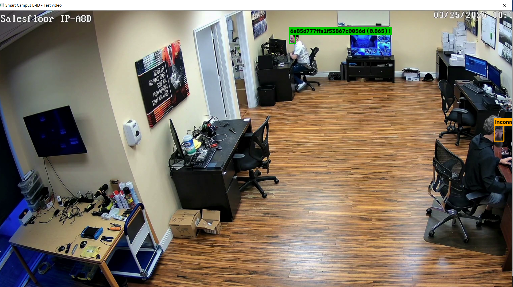
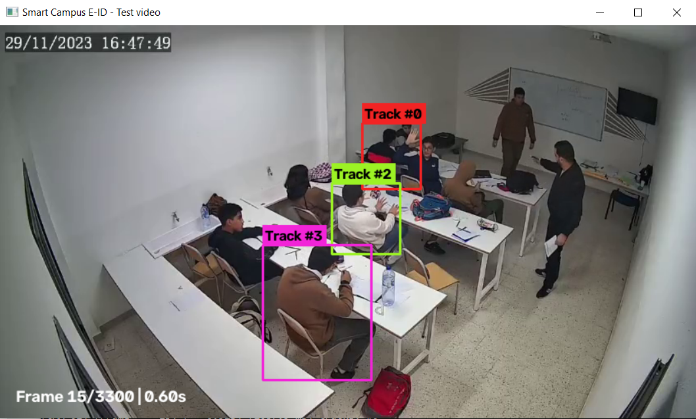
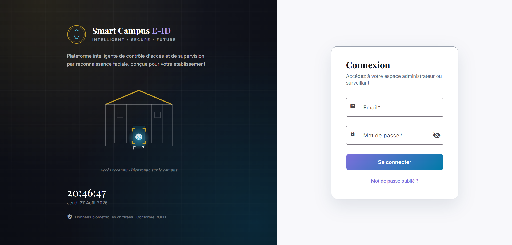
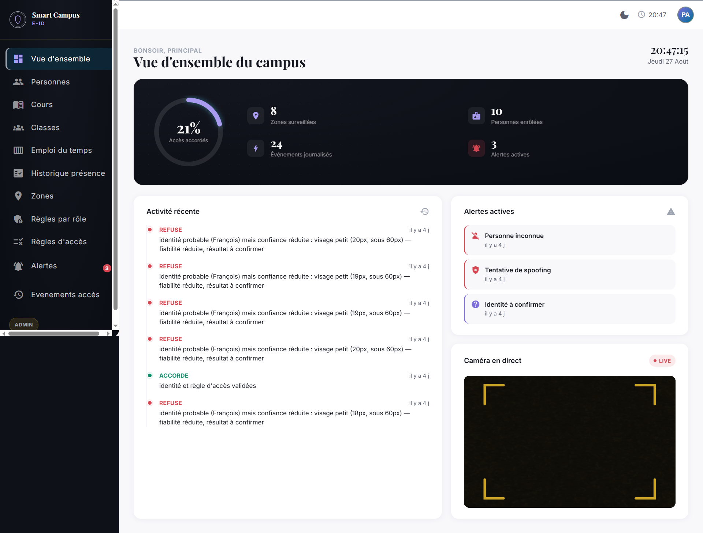
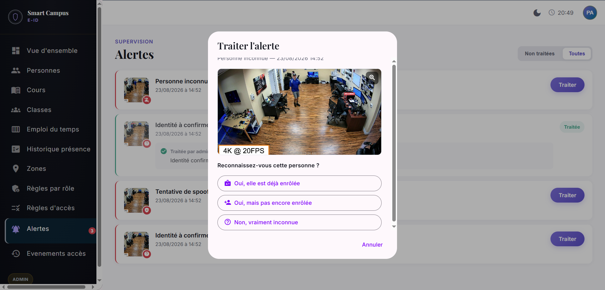
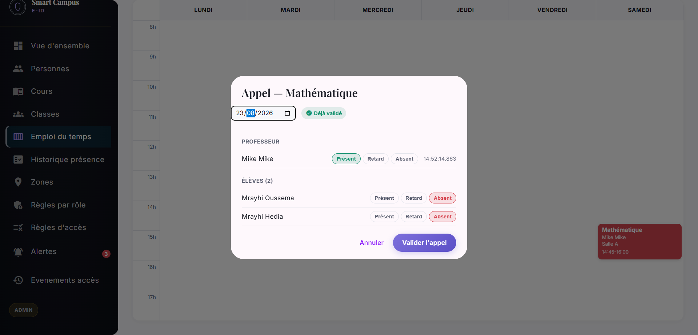
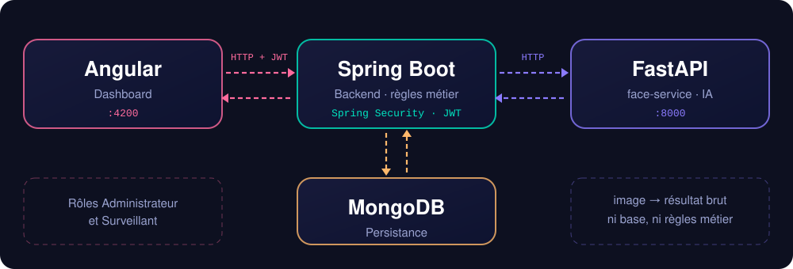
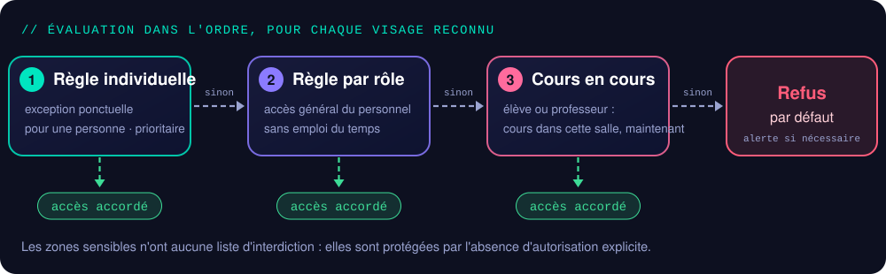

<div align="center">


<br/>


<br/><br/>

**Caméra → IA → identification → règles métier → décision → événement / présence / alerte**

*Projet réalisé par [Siwar Mrayhi](https://github.com/siwarmrayhi) dans le cadre du Projet de Fin d'Année (PFA).*

</div>

<br/>



---

## 📌 Vue d'ensemble

**Smart Campus E-ID** analyse le flux de caméras, identifie les personnes grâce à l'intelligence artificielle, décide si leur présence est **autorisée à cet endroit et à cet instant**, puis génère selon le cas un **accès accordé**, une **présence enregistrée** ou une **alerte**.

La reconnaissance faciale n'est qu'un maillon d'une chaîne plus large : le système croise l'identité reconnue avec des règles d'accès, des rôles et un emploi du temps réel avant de décider.

## 📸 Aperçu de l'application

<table>
  <tr>
    <td align="center" width="50%" valign="top">
      <br/>
      <b>Reconnaissance faciale</b><br/>
      <sub>Détection et identification des visages dans le flux caméra, avec cadre et étiquette sur la personne concernée.</sub>
    </td>
    <td align="center" width="50%" valign="top">
      <br/>
      <b>Tracking des personnes avec ByteTrack</b><br/>
      <sub>Détection de personnes (MediaPipe) et suivi (ByteTrack), exposés sur <code>/track</code>.</sub>
    </td>
  </tr>
  <tr>
    <td align="center" valign="top">
      <br/>
      <b>Authentification</b><br/>
      <sub>Connexion par compte Administrateur ou Surveillant, sécurisée par JWT.</sub>
    </td>
    <td align="center" valign="top">
      <br/>
      <b>Dashboard : vue d'ensemble</b><br/>
      <sub>Indicateurs clés de l'activité du campus.</sub>
    </td>
  </tr>
  <tr>
    <td align="center" valign="top">
      <br/>
      <b>Alertes en temps réel</b><br/>
      <sub>Alertes avec capture annotée, à traiter selon leur type.</sub>
    </td>
    <td align="center" valign="top">
      <br/>
      <b>Appel de présence en temps réel</b><br/>
      <sub>Appel pré-rempli à partir des passages réels et de l'emploi du temps.</sub>
    </td>
  </tr>
</table>

## 📑 Sommaire

- [Aperçu de l'application](#-aperçu-de-lapplication)
- [Fonctionnalités](#-fonctionnalités)
- [Autres écrans du dashboard](#-autres-écrans-du-dashboard)
- [Architecture](#-architecture)
- [Modèles et pipeline de reconnaissance](#-modèles-et-pipeline-de-reconnaissance)
- [Décision d'accès](#-décision-daccès)
- [Modèle de données](#-modèle-de-données)
- [Structure du projet](#-structure-du-projet)
- [Installation et lancement](#-installation-et-lancement)
- [Authentification et comptes](#-authentification-et-comptes)
- [Tester avec une vidéo](#-tester-avec-une-vidéo)
- [Dépannage](#-dépannage)
- [Limites connues](#-limites-connues)
- [Technologies utilisées](#-technologies-utilisées)

---

## ✨ Fonctionnalités

| | Fonctionnalité | Ce qu'elle apporte |
|:-:|---|---|
| 🧠 | **Reconnaissance faciale** | Détection SCRFD et embeddings ArcFace de 512 dimensions, comparés par similarité cosinus. |
| 🛡️ | **Anti-spoofing** | Vote d'ensemble de plusieurs modèles Silent-Face pour écarter les photos et les écrans. |
| 🔐 | **Décision d'accès à 3 niveaux** | Règle individuelle, règle par rôle, cours en cours, avec **refus par défaut**. |
| 📋 | **Appel de présence pré-rempli** | Généré automatiquement à partir des passages réels et de l'emploi du temps. |
| 📸 | **Capture photo annotée** | Cadre et étiquette sur la personne exacte concernée par chaque décision. |
| ⏱️ | **Cooldown anti-spam** | 5 minutes pour les alertes, 30 secondes pour la journalisation. |
| 🚨 | **Traitement spécialisé des alertes** | Confirmer ou corriger une identité, associer une personne existante, enrôler directement depuis l'alerte. |
| 🔑 | **Sécurité** | Authentification JWT, réinitialisation du mot de passe par email, déconnexion automatique à l'expiration de la session. |
| 🌗 | **Interface** | Mode clair et mode sombre. |
| 📤 | **Exports** | Historique des appels en CSV, Excel, PDF et Word. |

### Pages du dashboard

Le dashboard est organisé en pages, accessibles depuis le menu latéral. Certaines sont réservées au rôle **Administrateur**.

| Page | Contenu | Accès |
|---|---|---|
| **Vue d'ensemble** | Indicateurs clés de l'activité du campus. | Admin, Surveillant |
| **Personnes** | Création, modification et enrôlement des personnes (photos, embedding facial). | Admin |
| **Zones** | Gestion des salles et espaces physiques surveillés. | Admin |
| **Règles d'accès** | Exceptions individuelles : une personne précise, une zone, un créneau. | Admin |
| **Règles par rôle** | Accès généraux par rôle, avec création groupée sur plusieurs zones. | Admin |
| **Classes** | Liste des élèves de chaque classe (un élève appartient à une seule classe). | Admin |
| **Cours** | Créneaux récurrents : classe, professeur, salle, jour et horaire. Les conflits sont détectés. | Admin |
| **Emploi du temps** | Vue semaine et vue jour, avec ouverture de l'appel depuis un cours. | Admin, Surveillant |
| **Alertes** | Six types d'alertes, avec capture annotée et traitement adapté au type. | Admin, Surveillant |
| **Événements d'accès** | Journal technique de chaque passage devant une caméra. | Admin, Surveillant |
| **Historique des appels** | Appels validés, recherche par classe et par date, export CSV, Excel, PDF et Word. | Admin |

---

## 📷 Autres écrans du dashboard

<table>
  <tr>
    <td align="center" width="33%"><br/><sub><b>Personnes enrôlées</b></sub></td>
    <td align="center" width="33%"><br/><sub><b>Traitement spécialisé d'une alerte</b></sub></td>
    <td align="center" width="33%"><br/><sub><b>Événements d'accès</b></sub></td>
  </tr>
  <tr>
    <td align="center"><br/><sub><b>Règles par rôle</b></sub></td>
    <td align="center"><br/><sub><b>Emploi du temps</b></sub></td>
    <td align="center"><br/><sub><b>Historique des appels</b></sub></td>
  </tr>
</table>

---

## 🧱 Architecture

Quatre services indépendants, qui communiquent uniquement en HTTP.

<div align="center">

</div>

Le service IA reçoit une image et renvoie un **résultat brut**. Il ne connaît ni la base de données, ni les règles d'accès, ni les emplois du temps. Le backend est le **seul** à croiser ce résultat avec la logique métier et à décider. Chaque brique est donc remplaçable sans toucher aux autres.

---

## 🧠 Modèles et pipeline de reconnaissance

Le service `face-service` traite chaque image selon la cascade suivante :

`Image → détection du visage → qualité → anti-spoofing → embedding → similarité → identité`

| Étape | Technique | Seuil |
|---|---|---|
| **Détection du visage** | SCRFD (via InsightFace `buffalo_l`) | score de détection ≥ 0,5 |
| **Qualité : angle** | Ratio de frontalité (distances œil-nez) | ≥ 0,35 |
| **Qualité : taille** | Largeur du visage | ≥ 60 px (en dessous : avertissement, pas de rejet) |
| **Anti-spoofing** | Silent-Face-Anti-Spoofing, vote d'ensemble de plusieurs modèles | classe « vivant » majoritaire |
| **Embedding** | ArcFace, vecteur de 512 dimensions | n/a |
| **Similarité** | Similarité cosinus avec les profils enrôlés | ≥ 0,4 |

À l'enrôlement, le profil d'une personne est la **moyenne des embeddings de 3 à 5 photos**.

Le projet comprend aussi un pipeline de suivi (MediaPipe pour la détection de personnes, ByteTrack pour le suivi), exposé sur `/track`. Il n'est pas encore relié à la reconnaissance.

<details>
<summary><b>Choix des modèles : ce qui a été testé, retenu ou écarté</b></summary>

<br/>

| Testé | Statut | Raison |
|---|---|---|
| dlib | Abandonné | Résultats insuffisants aux tests réels |
| HOG | Abandonné | Faux positifs confirmés (téléviseur, cartons, chaises détectés comme personnes) |
| SSD MobileNet | Abandonné | Incompatibilité poids / configuration jamais résolue |
| YOLO | Écarté | Licence AGPL-3.0 |
| BoT-SORT | Écarté | Licence AGPL-3.0 |
| MediaPipe, ByteTrack, Silent-Face | Retenus | Licence Apache 2.0 |
| InsightFace | Retenu | Précision de référence, licence non commerciale |

</details>

### 🧬 Protection des profils

Une reconnaissance n'est **jamais** intégrée automatiquement à un profil. Un embedding candidat doit passer quatre filtres :

1. liveness confirmé ;
2. confiance ≥ 0,6 ;
3. visage ≥ 60 px ;
4. cohérence avec le profil existant (similarité ≥ 0,55).

Il reste ensuite en attente d'une **validation humaine explicite**.

---

## 🔐 Décision d'accès

Pour chaque visage reconnu, le backend évalue dans l'ordre :

<div align="center">

</div>

1. **Règle individuelle** : exception ponctuelle pour une personne précise, prioritaire.
2. **Règle par rôle** : accès général pour le personnel sans emploi du temps (surveillants, direction).
3. **Cours en cours** : pour un élève ou un professeur, le système vérifie s'il a un cours dans cette salle à cet instant.

Si aucun des trois niveaux ne couvre la situation, l'accès est **refusé par défaut**. Les zones sensibles n'ont donc aucune liste d'interdiction : elles sont protégées par l'absence d'autorisation explicite.

---

## 💾 Modèle de données

| Entité | Rôle |
|---|---|
| **Personne** | Personne reconnue par les caméras (élève, professeur, personnel), avec son embedding. |
| **Utilisateur** | Compte de connexion au dashboard (Admin ou Surveillant). Distinct de Personne. |
| **Zone** | Salle ou espace physique. |
| **Classe** | Liste des élèves d'une classe. |
| **Cours** | Classe, professeur, salle, jour et horaire. |
| **RegleAcces / RegleAccesRole** | Règles individuelles et règles par rôle. |
| **EvenementAcces** | Journal technique de chaque passage. Distinct de PresenceCours. |
| **PresenceCours** | Appel validé pour une séance (registre pédagogique). |
| **Alerte** | Notification à traiter, avec capture annotée. |

---

## 📁 Structure du projet

```text
smart-campus-repo/
├── dashboard/            Frontend Angular
├── backend/              Backend Spring Boot
├── face-service/         Service IA Python / FastAPI
│   ├── app/
│   │   ├── routers/      Endpoints HTTP (recognition.py)
│   │   ├── services/     face_engine, liveness, tracker, track_manager, embedding_candidates
│   │   └── models/       Schémas Pydantic
│   ├── models/           Modèle MediaPipe (efficientdet_lite0.tflite)
│   └── requirements.txt
├── camera-client/        Scripts de test : flux vidéo vers face-service ou backend
├── silent_face/          Dépôt externe Silent-Face-Anti-Spoofing (cloné séparément)
├── docs/
│   ├── assets/           Visuels de ce README
│   └── screenshots/      Captures d'écran utilisées dans ce README
└── README.md
```

---

## 🚀 Installation et lancement

### Prérequis

- Java 21 et Maven
- Python 3.12 (recommandé)
- Node.js 20 ou plus, avec Angular CLI
- MongoDB 8
- Git

> Sous Windows, cochez « Add python.exe to PATH » pendant l'installation de Python.

### Ordre de démarrage

Les quatre services doivent être lancés dans cet ordre : **MongoDB → face-service → backend → dashboard**. Le backend recharge les embeddings vers face-service à son démarrage, donc face-service doit être prêt avant lui.

### 1. MongoDB

Démarrez le service MongoDB (service système, ou `mongod --dbpath <dossier>` sans droits administrateur).

### 2. face-service

```bash
cd face-service
python -m venv venv
venv\Scripts\activate            # Linux / WSL : source venv/bin/activate
pip install -r requirements.txt
```

Les versions suivantes doivent être figées, car leurs dépendances se perturbent mutuellement :

```bash
pip install torch==2.3.1 --index-url https://download.pytorch.org/whl/cpu
pip uninstall -y opencv-python opencv-contrib-python opencv-python-headless
pip install "opencv-python-headless==4.10.0.84"
pip install "numpy<2"
```

> ⚠️ Réinstallez OpenCV **en dernier** à chaque ajout de paquet : plusieurs bibliothèques (mediapipe, trackers, supervision) réinstallent leur propre version d'OpenCV.

<details>
<summary><b>Silent-Face-Anti-Spoofing et modèle MediaPipe</b></summary>

<br/>

Récupérez Silent-Face-Anti-Spoofing. Sous Windows, téléchargez le zip de <https://github.com/minivision-ai/Silent-Face-Anti-Spoofing/archive/refs/heads/master.zip> (un `git clone` échoue à cause d'un nom de fichier se terminant par une espace), puis placez le contenu dans `silent_face/`. Sous Linux, `git clone` fonctionne.

Téléchargez le modèle MediaPipe dans `face-service/models/` :

```text
https://storage.googleapis.com/mediapipe-models/object_detector/efficientdet_lite0/int8/1/efficientdet_lite0.tflite
```

</details>

Définissez la variable d'environnement vers le dépôt Silent-Face, puis lancez le service :

```powershell
$env:SILENT_FACE_REPO_PATH = "C:\chemin\vers\silent_face"     # Linux : export SILENT_FACE_REPO_PATH=...
uvicorn app.main:app --reload
```

Vérification : <http://localhost:8000/health> doit répondre `{"status":"ok", ...}`.

### 3. Backend

Dans `backend/src/main/resources/application.properties`, vérifiez :

```properties
spring.data.mongodb.host=localhost
spring.data.mongodb.port=27017
face-service.base-url=http://localhost:8000
```

Puis :

```bash
cd backend
mvn spring-boot:run
```

### 4. Dashboard

```bash
cd dashboard
npm install
npm install xlsx jspdf jspdf-autotable
ng serve -o
```

L'application s'ouvre à l'adresse <http://localhost:4200>.

---

## 🔑 Authentification et comptes

L'accès au dashboard repose sur des comptes **Administrateur** et **Surveillant**, authentifiés par JWT. Les mots de passe sont hachés (BCrypt). Un compte administrateur est créé au premier démarrage du backend (voir `DataInitializer.java`) : **changez son mot de passe dès la première connexion**.

<details>
<summary><b>Réinitialisation du mot de passe par email</b></summary>

<br/>

Ajoutez dans `application.properties` :

```properties
spring.mail.host=smtp.gmail.com
spring.mail.port=587
spring.mail.username=VOTRE_EMAIL@gmail.com
spring.mail.password=MOT_DE_PASSE_D_APPLICATION
spring.mail.properties.mail.smtp.auth=true
spring.mail.properties.mail.smtp.starttls.enable=true
app.frontend-url=http://localhost:4200
```

Le mot de passe d'application se génère sur <https://myaccount.google.com/apppasswords> (validation en deux étapes requise). N'utilisez jamais le mot de passe réel du compte. Le lien reçu par email est valable une heure.

</details>

---

## 🎬 Tester avec une vidéo

Le script `camera-client/backend_client.py` envoie les images d'une vidéo au backend et affiche les décisions.

```bash
python backend_client.py "chemin\vers\video.mp4" --zone-id <ID_DE_LA_ZONE> --every-n-frames 25 --email <EMAIL> --password <MOT_DE_PASSE>
```

L'identifiant de la zone se lit dans la réponse de l'API `/api/zones` (onglet Réseau des outils de développement du navigateur). Les résultats apparaissent ensuite dans les pages **Alertes** et **Événements d'accès**.

---

## 🔧 Dépannage

<details>
<summary><b>Problèmes fréquents et solutions</b></summary>

<br/>

| Problème | Solution |
|---|---|
| `venv\Scripts\activate` refuse de s'exécuter | `Set-ExecutionPolicy RemoteSigned -Scope CurrentUser` |
| `git clone` de Silent-Face échoue sous Windows | Télécharger le zip (voir installation). |
| `AttributeError: module 'cv2' has no attribute 'dnn'` ou `readNetFromCaffe` | Mauvaise version d'OpenCV : supprimer `site-packages\cv2`, puis `pip install "opencv-python-headless==4.10.0.84" --force-reinstall`. |
| `No module named 'torchgen'` | Version de PyTorch trop récente : installer `torch==2.3.1`. |
| `Numpy is not available`, tous les visages classés « spoofing » | NumPy 2 incompatible avec PyTorch 2.3 : `pip install "numpy<2"`. |
| `No module named 'src'` au démarrage de face-service | `SILENT_FACE_REPO_PATH` n'est pas défini dans ce terminal. |
| `MongoSocketOpenException` au démarrage du backend | MongoDB n'est pas démarré. |
| Erreurs 403 dans le dashboard | Session expirée : le dashboard redirige vers la connexion. |
| Aucun email de réinitialisation reçu | Mot de passe d'application non configuré, ou compte avec une adresse email fictive. |

</details>

---

## 🚧 Limites connues

| Limite | Impact | Piste |
|---|---|---|
| Environ 2 s de traitement par frame sur CPU | Une personne qui traverse vite peut ne pas être traitée. | Accélération GPU |
| Suivi et reconnaissance non liés | InsightFace est appelé à chaque frame plutôt qu'une fois par personne suivie. | Associer `track_id` et identité |
| Mono-caméra | Une personne qui change de caméra devient une nouvelle identité. | Ré-identification inter-caméras |
| InsightFace sous licence non commerciale | Bloquant pour une commercialisation. | Évaluer une alternative permissive |

Aucune évaluation quantitative (taux de faux positifs et de faux négatifs) n'a été réalisée : elle nécessiterait un jeu de test annoté, hors du périmètre du PFA.

---

## 🧰 Technologies utilisées

<div align="center">

</div>

---

<div align="center">

## 👩‍💻 Auteure

**Siwar Mrayhi**, projet réalisé dans le cadre du Projet de Fin d'Année (PFA).

<a href="https://github.com/siwarmrayhi"></a>
<a href="https://linkedin.com/in/siwar-mrayhi"></a>

</div>
